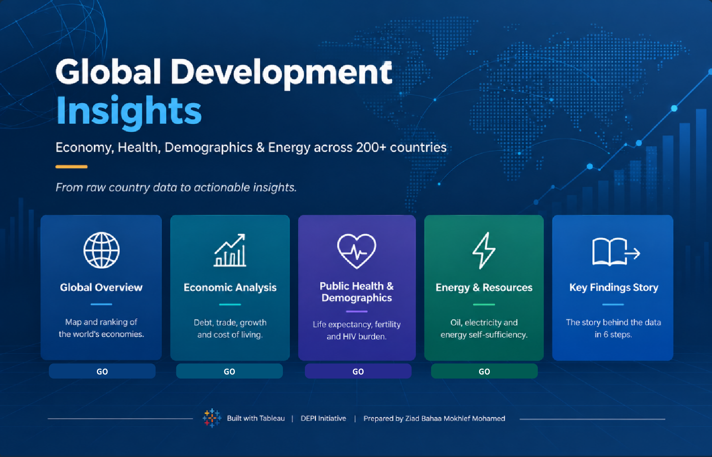

<div align="center">

# 🌍 Global Development Insights

### An Interactive Tableau Storytelling Project Exploring Global Economic, Demographic, Public Health, and Energy Indicators


[**Explore on Tableau Public**](https://public.tableau.com/app/profile/ziad.bahaa/viz/Mini_Project_3_Dashboard/EnergyResources) · [**Project Report (PDF)**](Dashboard/Mini_Project_3_Dashboard.pdf) · [**Presentation (PPTX)**](Dashboard/Mini_Project_3_Dashboard.pptx)

</div>

---

## 📌 Project Overview

How do countries compare in terms of economic performance, public health, population dynamics, and energy resources?

**Global Development Insights** is an interactive Tableau project that transforms country-level data into an accessible analytics experience. It helps users explore differences between countries, identify relationships between development indicators, and investigate potential economic and public health challenges.

The project covers **261 countries and territories** across four major domains:

* 🌐 Global economic performance
* 💰 Economic stability and financial risk
* 🏥 Public health and demographics
* ⚡ Energy production, consumption, and reserves

Rather than presenting isolated statistics, the project emphasizes data exploration, meaningful comparisons, and evidence-based interpretation.

## 🎯 Project Objectives

* Compare countries across economic, demographic, health, and energy indicators.
* Explore relationships between GDP per capita and development outcomes.
* Identify countries facing high public debt and economic pressure.
* Examine differences in life expectancy, infant mortality, fertility, and HIV burden.
* Compare energy production and consumption and estimate oil reserve longevity.
* Present complex data through interactive dashboards and a structured Tableau Story.

## ✨ Project Highlights

* **4 interactive analytical dashboards** covering distinct development domains.
* **17 visualizations** using maps, bar charts, scatter plots, box plots, histograms, and other chart types.
* **15+ calculated fields** for derived indicators and analytical comparisons.
* **3 parameters:** Select Indicator, Top N, and Debt Threshold.
* Interactive filters, highlighting, dashboard actions, and navigation.
* A consistent visual design using a fixed 1400 × 900 canvas and coordinated color themes.
* A Tableau Story designed to guide users through the major findings.

## 🖼️ Dashboard Previews

### Home



### Global Overview


### Economic Analysis


### Public Health & Demographics


### Energy & Resources


## 📊 Dashboard Guide

| Dashboard                        | Main Questions                                                                    | Key Visualizations                                                                              |
| -------------------------------- | --------------------------------------------------------------------------------- | ----------------------------------------------------------------------------------------------- |
| **Global Overview**              | How do countries compare in economic size, income, and population?                | GDP per capita map, GDP ranking, population density                                             |
| **Economic Analysis**            | Where are the economic pressures and financial risks?                             | Indicator Explorer, Debt vs. Growth, Trade Balance, Misery Index, outlier analysis              |
| **Public Health & Demographics** | How are income, health outcomes, and population dynamics related?                 | GDP vs. Life Expectancy, Health Efficiency, Fertility vs. GDP, Birth vs. Death Rate, HIV Burden |
| **Energy & Resources**           | Which countries produce and consume energy, and how long might oil reserves last? | Oil Production vs. Consumption, Oil Reserve Years, Electricity per Capita vs. GDP               |

## 🗂️ Dataset

The project uses a country-level dataset stored in an Excel workbook:

**File:** `Dataset/Country Data Comparison.xlsx`

The dataset contains indicators from four domains.

| Domain            | Selected Indicators                                                                                                                      |
| ----------------- | ---------------------------------------------------------------------------------------------------------------------------------------- |
| **Economy**       | GDP, GDP per capita, real GDP growth, inflation, exports, imports, current account, external debt, public debt, unemployment, investment |
| **Demographics**  | Population, land area, birth rate, death rate, fertility rate                                                                            |
| **Public Health** | Life expectancy, infant mortality, HIV/AIDS prevalence, deaths and people living with HIV/AIDS                                           |
| **Energy**        | Electricity production and consumption, oil and natural gas production and consumption, proved oil reserves                              |

The dataset contains **261 countries and territories**. Indicator availability, reporting periods, and definitions may differ between countries.

> **Important:** This is a cross-sectional snapshot rather than a longitudinal dataset. Therefore, the project primarily explores relationships, distributions, and differences between countries rather than changes over time.

## 🧮 Engineered Metrics

Several calculated indicators were developed to support comparisons and highlight potential risks.

| Metric                           | Calculation / Logic                                                                      | Analytical Purpose                                                          |
| -------------------------------- | ---------------------------------------------------------------------------------------- | --------------------------------------------------------------------------- |
| **Health Efficiency**            | Life expectancy relative to the average for the same income tier                         | Identifies countries performing above or below their income-group benchmark |
| **Misery Index**                 | Unemployment rate + inflation rate                                                       | Provides a simplified indicator of economic pressure                        |
| **Debt Risk**                    | Public debt as a percentage of GDP compared with a configurable threshold                | Flags countries with high public debt ratios                                |
| **Oil Reserve Years**            | Proved oil reserves ÷ (annual oil production × 365), when production is recorded per day | Estimates how long reserves could last at the current production rate       |
| **Population Density**           | Population ÷ land area                                                                   | Compares population concentration                                           |
| **Electricity Self-Sufficiency** | Electricity production ÷ electricity consumption                                         | Compares domestic electricity production with consumption                   |

These metrics are analytical simplifications and should be interpreted in the context of their assumptions and the underlying data.

For detailed methodology and implementation notes, see the [project report](Doc/Global%20Development%20Insights%20-%20Project%20Report.docx).

## 🔍 Key Insights

* The dataset covers **261 countries and territories**, representing a broad range of economic and development conditions.
* Global GDP is concentrated among major economies, including the United States, China, Japan, India, and Germany.
* Life expectancy generally increases with GDP per capita, but the relationship becomes less pronounced at higher income levels.
* Economic indicators such as inflation, unemployment, trade balance, and public debt help distinguish different forms of economic pressure.
* Energy production, consumption, and proved reserves provide different perspectives on countries' energy positions.

These findings describe patterns in the dataset. They do not establish causal relationships, and country-level comparisons should account for differences in data quality, definitions, and reporting periods.

## 🛠️ Tools & Skills

**Primary Tool**

* Tableau Desktop / Tableau Public

**Data Source**

* Microsoft Excel (`.xlsx`)

**Skills Demonstrated**

* Data exploration and quality assessment
* Data visualization and analytical storytelling
* Calculated fields and parameter-driven analysis
* Interactive filters and dashboard actions
* KPI design and dashboard navigation
* Cross-country comparison
* Visual design and dashboard usability
* Analytical documentation and interpretation

## 📁 Repository Structure

```text
Mini_Project_3/
│
├── Dashboard/
│   ├── Global Development Insights Dashboard
│   ├── Mini_Project_3_Dashboard.pdf
│   └── Mini_Project_3_Dashboard.pptx
│
├── Dataset/
│   └── Country Data Comparison.xlsx
│
├── Doc/
│   ├── Global Development Insights - Project Report.docx
│   └── Mini_Project_3_Description.docx
│
├── Images/
│   ├── Economic Analysis.png
│   ├── Energy & Resources.png
│   ├── Global Overview.png
│   ├── HOME.png
│   └── Public Health & Demographics.png
│
├── Mini_Project_3_Dashboard.twbx
└── README.md
```

*Note: The Tableau workbook and documentation filenames above follow the project structure. The README assumes the dashboard preview file inside `Dashboard/` is the PDF shown in the repository.*

## 🚀 How to Explore the Project

### Option 1: Tableau Public

Open the [interactive dashboard on Tableau Public](https://public.tableau.com/app/profile/ziad.bahaa/viz/Mini_Project_3_Dashboard/EnergyResources) to explore the published visualizations.

### Option 2: Tableau Desktop / Tableau Public

1. Download or clone this repository.
2. Open `Mini_Project_3_Dashboard.twbx` in Tableau Desktop or Tableau Public.
3. Explore the dashboards using the available filters, parameters, and navigation controls.

The `.twbx` format is a packaged Tableau workbook and can include the workbook's supporting data and resources.

### Option 3: Review the Documentation

* **[Project Report (Word)](Doc/Global%20Development%20Insights%20-%20Project%20Report.docx):** Business scenario, methodology, design decisions, challenges, and future improvements.
* **[Project Description](Doc/Mini_Project_3_Description.docx):** Project description and requirements.
* **[Dashboard PDF](Dashboard/Mini_Project_3_Dashboard.pdf):** Static dashboard reference.
* **[Dashboard Presentation](Dashboard/Mini_Project_3_Dashboard.pptx):** Presentation version of the project.

## ⚠️ Limitations

* **Cross-sectional data:** The dataset does not support direct analysis of changes over time.
* **Correlation vs. causation:** Observed relationships do not establish causal effects.
* **Reporting differences:** Indicator definitions, data availability, and reference years may vary between countries.
* **Country-level averages:** Treating every country equally does not account for differences in population size.
* **Derived metrics:** Simplified indicators depend on their formulas and assumptions and should not be interpreted as definitive measures of national performance.

## 📚 Documentation

The project documentation includes the project description, analytical methodology, dashboard design decisions, and supporting presentation materials.

See the files in the [`Doc`](Doc/) and [`Dashboard`](Dashboard/) folders for additional details.

## 👨‍💻 Author

**Ziad Bahaa Mokhlef Mohamed**

Medical Student | Data Analytics Enthusiast
DEPI Initiative — Mini-Project 3

[LinkedIn](https://www.linkedin.com/in/dr-ziad-bahaa/) · [Upwork](https://www.upwork.com/freelancers/~018d7e0b55b5e57837)

---

If you find this project useful, consider giving the repository a ⭐.
